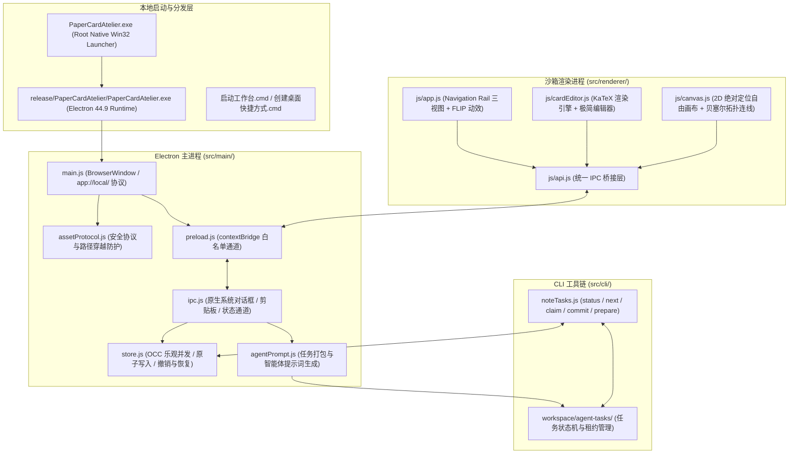

# PaperCard Atelier · 纸质手写笔记识别与重构工作台

<p align="center">
  <b>本地原生桌面架构 · 纸质手写笔记识别 · 可编辑卡片拆分 · 题解归属 · 2D 自由画布重构</b>
</p>

<p align="center">
  <a href="LICENSE"></a>
  <a href="package.json"></a>
  <a href="package.json"></a>
  <a href="package.json"></a>
</p>

---

## 📖 项目简介

**PaperCard Atelier** 是一款专为纸质笔记、理科手写推导、错题集与学术札记量身打造的本地原生桌面工作台。

传统的扫描软件往往只能生成不可二次编辑的整页静态死图，而常规 OCR 工具又会破坏手写纸张原本精妙的二维空间排版、公式结构与图文对应关系。PaperCard Atelier 提出并实践了**「原纸映射 ➔ 分区裁切 ➔ 结构化卡片 ➔ 知识库与自由画布」**的现代化重构理念：

- **原纸排版映射**：完整保留手写原纸的网格与版式空间几何坐标；
- **智能体三阶段协作闭环**：通过确定性状态机约束外部 AI 智能体完成高精度转录、逐卡录入与全局拓扑合成；
- **纯净数学公式排版**：内置全离线 KaTeX 引擎，实现高质量排版预览；
- **2D 自由重构画布**：将零散笔记重组为网状知识图谱与题解结构树；
- **绝对隐私与纯净框架**：开源仓库仅包含完整桌面软件框架与状态模板，用户本地导入的手写笔记、切片图像与私有数据完全由用户掌控，零数据外泄。

---

## 🌟 核心功能特色

### 1. 原纸交互与高保真选区（Paper Inspection & Partitioning）
- **多边形与矩形 BBox 选区**：支持自由绘制多边形区域或标准化矩形边界框，自适应复杂版面；
- **原纸视口增强**：支持原纸缩放（Zoom In/Out）、画布自适应与 90° 自由旋转；
- **原图裁切与切片缓存**：自动基于选区提取归一化切片（Crop），同时支持原纸栅格共享与按需图片预览缓存。

### 2. 外部智能体三阶段任务工作流（Three-Stage Agent Workflow）
软件右上角提供**一键复制智能体提示词**（Copy Agent Prompt）机制，外部多模态 Agent 通过调用内置本地 CLI（`src/cli/noteTasks.js`）严格按序推进：
1. **阶段 1：逐页识别与区域划分 (`page_partition`)**
   - 提取页面全局摘要、原始排版几何，逐一标定分区类型（题目 `problem`、过程 `process`、关键步骤 `key_step`、图表 `figure`、公式 `formula_block`、思考 `thought`、文章 `article`）与字号层级。
2. **阶段 2：逐区填充可编辑卡片 (`region_card_fill`)**
   - 逐个分区转录文字与 LaTeX 公式，记录同页关联（`intraPageLinks`）与跨页延续推测（`crossPageHypotheses`），支持整页批量提交（`savePageCards`）。
3. **阶段 3：全局拓扑合成与知识库整理 (`global_synthesis`)**
   - 在所有卡片录入完毕后统一合成：建立跨页题解树（`problemTrees`）、计算 2D 画布排布坐标（`canvasLayout`），并归集至学科/科目/章节体系（`taxonomyAssignments`）。

### 3. 精纯数学公式与卡片排版引擎（Math & Typography）
- **离线 KaTeX 渲染**：本地内置 KaTeX，脱离在线 CDN 限制；
- **数学表达式高保真格式化**：自动处理上下标、导数撇号、极限无穷、二项分式与题解符号；
- **整卡响应与极简编辑器**：点击卡片任意区域即可联动定位原纸分区并打开三区块卡片编辑器，支持实时渲染双栏对照与手写截图/矢量重绘双轨切换。

### 4. 2D 自由无限画布（Infinite Canvas & Graph Visualizer）
- **节点化视图**：紧凑展示知识卡片节点，消除视觉冗余；
- **贝塞尔关联线**：直观展示题解逻辑链与跨页推导脉络；
- **多主题看板**：按学科/批次自动聚类，支持用户自定义主题看板与独立排布保存。

### 5. 现代化桌面架构与安全可靠性（Architecture & Robustness）
- **Electron `app://` 特权协议**：纯粹的原生桌面交互，无暴露的 Web 服务端口；
- **Preload 白名单 IPC**：严格隔离主进程与渲染进程，杜绝任意代码执行风险；
- **乐观并发控制 (OCC) 与原子落盘**：`state.revision` 版本锁机制，多进程/并发写入自动校验冲突；任务租约锁（Lease Mechanism）防止多 Worker 重复抢占。

---

## 🏗️ 架构概览



---

## 📂 项目结构

```text
paper-card-atelier/
├── src/
│   ├── main/                       # Electron 主进程模块
│   │   ├── main.js                 # 桌面主窗口生命周期管理
│   │   ├── store.js                # 原子持久化存储引擎与乐观并发控制
│   │   ├── ipc.js                  # IPC 通道处理与原生能力集成
│   │   ├── assetProtocol.js        # app:// 安全协议与静态资源拦截
│   │   ├── preload.js              # contextBridge 安全白名单桥接
│   │   └── agentPrompt.js          # 外部智能体任务打包与提示词生成
│   ├── renderer/                   # 桌面沙箱渲染进程
│   │   ├── index.html              # Material 3 毛玻璃界面结构
│   │   ├── styles/                 # 设计 Token、样式与主题体系
│   │   └── js/                     # 视图路由、卡片编辑、数学排版与画布引擎
│   ├── shared/                     # 主/渲染/CLI 进程共享契约
│   │   └── contracts.js            # 阶段状态机、数据模型与校验器
│   └── cli/                        # 外部智能体调用接口
│       └── noteTasks.js            # 本地 CLI 工具 (status/next/claim/commit)
├── workspace/                      # 本地工作区（用户内容隔离）
│   ├── workspace-state.template.json # 纯净空框架状态模板
│   ├── pages/                      # 用户手写扫描件存储（.gitkeep，不入库）
│   ├── crops/                      # 选区裁切切片存储（.gitkeep，不入库）
│   └── agent-tasks/                # 智能体任务临时缓存（.gitkeep，不入库）
├── scripts/                        # 构建、打包与自动化场景脚本
│   ├── build-desktop.js            # 桌面应用构建流水线
│   ├── launch-desktop.js           # 桌面启动脚本
│   └── Launcher.cs                 # Win32 C# 启动器源码
├── skills/                         # 智能体技能标准规范
├── tests/                          # 单元测试与契约验证套件
├── package.json                    # 工程配置文件
├── LICENSE                         # 开源协议 (MIT)
└── README.md                       # 项目说明文档
```

---

## 🚀 快速上手

### 环境准备
- **操作系统**：Windows 10 / 11 (x64)
- **Node.js**：18.0.0 或更高版本
- **包管理器**：npm

### 安装与运行

1. **克隆仓库**：
   ```bash
   git clone https://github.com/kelai061/notebook-manage.git
   cd notebook-manage
   ```

2. **运行测试套件（验证环境与数据契约）**：
   ```bash
   npm test
   ```

3. **构建本地桌面端**：
   ```bash
   npm run build:desktop
   ```

4. **启动桌面工作台**：
   ```bash
   npm start
   ```
   或者直接双击根目录下的 `启动工作台.cmd` 或 `PaperCardAtelier.exe`。

---

## 🔒 隐私安全与数据保护

PaperCard Atelier 遵循**「用户数据绝对本地化」**的设计准则：

1. **零内容预置**：本仓库作为开源框架发布，不携带任何个人手写扫描图片或预填充笔记内容。克隆仓库后，系统将自动基于 `workspace/workspace-state.template.json` 初始化一个干净的状态框架。
2. **严密的忽略策略**：`.gitignore` 严格忽略所有用户手写原图（`workspace/pages/*`）、选区切片图（`workspace/crops/*`）、草稿数据（`workspace/agent-tasks/*`）及运行时快照（`workspace/*.json`），确保开发者在提交代码时绝不泄露个人笔记隐私。
3. **安全路径防穿越**：内置的 `assetProtocol` 协议仅限访问应用内部资源与当前工作区，禁止访问工作区外部任意文件。

---

## 🤝 参与贡献

欢迎对理科笔记数字化、手写公式排版与知识图谱感兴趣的开发者共同建设！

1. Fork 本仓库；
2. 新建特性分支 (`git checkout -b feat/my-feature`)；
3. 确保所有单元测试通过 (`npm test`)；
4. 提交更改 (`git commit -m "feat: add amazing feature"`)；
5. 推送分支 (`git push origin feat/my-feature`)；
6. 提交 Pull Request。

---

## 📄 开源许可证

本项目基于 [MIT License](LICENSE) 开源发布。
