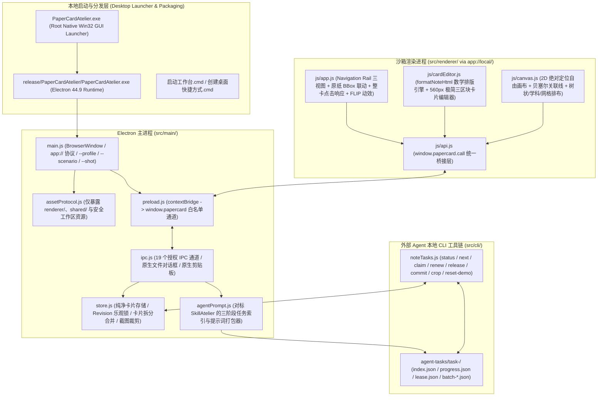

# PaperCard Atelier（纸质笔记重新构建工作台）— 大型桌面软件工程规范 (SPEC.md)

- **文档版本**：v3.0 (Round 3 彻底肃清外部污染、对标 SkillAtelier 极简 M3 毛玻璃重构版)
- **项目工程**：PaperCard Atelier 开源工作区
- **桌面基线**：原生桌面架构 (`Electron` + `app://` 协议 + `preload` 白名单 IPC + `92px` Navigation Rail + `64px` 极简 Appbar + 独立 Win32 启动器)
- **遵循技能规范**：`spec-driven-development`、`planning-and-task-breakdown`、`incremental-implementation`、`frontend-ui-engineering`、`code-review-and-quality`、`evaluation`、`filesystem-context`、`context-compression`（**严禁读取任何外部失败项目或无关历史技能**）

---

## 1. 目标与问题定义 (Objective & Problem Statement)

将纸张上的手写笔记识别、拆分为可编辑结构化卡片，同时保留原纸排版空间映射，并支持题解层级归属、学科章节整理与 2D 自由画布重排。

### 1.1 第 3 轮核心检讨与重构要求
1. **彻底清除旧项目污染与冗余字段**：
   - 终止第 1、2 轮受污染的旧子智能体，启用全新、无污染的 `pro` 子智能体。
   - 从数据模型（`contracts.js`、`store.js`）、外部 CLI（`noteTasks.js`、`agentPrompt.js`）到前端渲染层（`index.html`、`app.js`、`cardEditor.js`、`canvas.js`），**100% 剔除冗余的四层模型字段**，回归纯粹、直观、高可读性的手写重构卡片模型（`title`、`regionType`、`editableContent`、`structureBlocks`、`figureInfo`、`intraPageLinks`、`crossPageHypotheses`）。
2. **1:1 对标 `SkillAtelier` 的 Material 3 极简毛玻璃界面架构**：
   - **左侧 `92px` Navigation Rail (`aside.rail`)**：顶部品牌徽标，中部三大核心视图入口（`原纸`、`卡片`、`画布`），底部 `外观` 主题切换按钮（支持冰川浅色 / 暗夜深色 / 暖纸护眼三套主题）。
   - **顶部 `64px` Appbar (`header.appbar`)**：左侧仅展示当前视图标题与精炼状态摘要，右侧 `.appbar__actions` **严格收敛为 3 个高频操作**（`导入纸张`、`复制给智能体`、`重置` 图标按钮），彻底移除原本杂乱堆叠的次级工具栏与英文胶囊徽章。
3. **纯净数学公式排版引擎 (`formatNoteHtml`) 与整卡单点即开响应**：
   - 实现无裸露 LaTeX 反斜杠命令的 `formatNoteHtml(rawText)` 数学与结构化排版引擎，自动将 `\implies`、`^2`、`^3`、`_1`、`\in`、`\infty`、`\frac{a}{b}` 等渲染为优美的数学角标、符号与分式，并彻底消除正文中重复拼接 `structureBlocks` 的排版缺陷。
   - 原纸视图右侧卡片流（`.stream-card-item`）与卡片工作台网格卡片（`.grid-card-item`）支持**点击卡片任意区域立即高亮关联原纸分区并弹出极简编辑框**，悬浮自动联动高亮原纸 BBox。
4. **极简三区块卡片编辑弹窗 (`#cardEditorModal`, `560px`)**：
   - 摒弃原本冗长的 8+ 文本框与双语说明，精简为：① 标题与一行三列元数据（`类型 / 科目 / 章节`）；② 单一高对比度可编辑正文框（`#editCardContent`）配实时数学排版预览（`#editCardPreview`）；③ 按需折叠的图形重绘与题解归属微调区（`#figureCompareSection`）。

---

## 2. 系统架构 (System Architecture)

---

## 3. 核心数据契约与 IPC 规范 (Contracts & IPC Channels)

唯一真相源位于 `src/shared/contracts.js`：
- **严格三阶段状态机 (`PHASES`)**：
  1. `page_partition`：逐页识别纸张内容并划分区域（`regions[]`），提取归一化 `bbox {x, y, w, h}` 与截图片段。
  2. `region_card_fill`：逐个分区填充纯净可编辑卡片（`title`、`regionType`、`editableContent`、`structureBlocks`、`figureInfo`、`intraPageLinks`、`crossPageHypotheses`）。
  3. `global_synthesis`：所有卡片完成后，最后统一提交全局关联确认（`relations[]`）、题解结构树（`problemTrees[]`）、画布坐标排布（`canvasLayout[]`）与学科/科目/章节分类（`taxonomyAssignments[]`）。
  4. `completed`：三阶段全部落盘校验通过。

---

## 4. 质量门禁与项目经理验收标准 (PM Acceptance Gates)

1. **契约、纯净度与排版单元测试门禁**：`npm test` 覆盖三阶段状态机、乐观锁版本冲突检测、卡片拆分与合并、图形重绘规则校验、UI 极简 DOM 结构与 `formatNoteHtml` 数学排版纯净度（11 项测试 100% 通过）。
2. **真实本地桌面启动与场景自动化门禁**：通过 `npm run verify:desktop` 启动真实 Electron 桌面窗口，自动验证整卡点击弹出极简编辑框、数学公式渲染、卡片工作台与 2D 自由画布绝对定位布局，并输出 5 张真实桌面窗口截图（`docs/shots/01~05-*.png`）执行逐张视觉审查。
